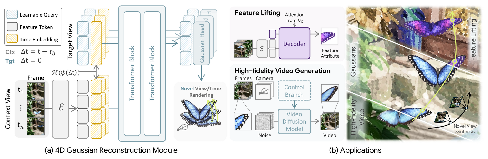

<p align="center">
  <h1 align="center">Learning Temporally Aware Compact Gaussians <br> for Feed-Forward 4D Reconstruction</h1>
  <p align="center">
    <a href="">Mungyeom Kim</a><sup>1*</sup>
    ·
    <a href="https://sites.google.com/view/minjeon/home">Minkyeong Jeon</a><sup>1*</sup>
    ·
    <a href="https://hg010303.github.io/">Honggyu An</a><sup>1*</sup>
    ·
    <a href="https://crepejung00.github.io/">Jaewoo Jung</a><sup>1</sup>
    ·
    <a href="">Hyunah Ko</a><sup>1</sup>
    ·
    <a href="https://onground.github.io/">Jisang Han</a><sup>1</sup>
    ·
    <a href="">Hyeonseo Yu</a><sup>1</sup>
    ·
    <a href="">Donghwan Shin</a><sup>1</sup>
    ·
    <a href="https://sunghwanhong.github.io/">Sunghwan Hong</a><sup>2</sup>
    ·
    <a href="">Takuya Narihira</a><sup>3</sup>
    ·
    <a href="">Kazumi Fukuda</a><sup>3</sup>
    ·
    <a href="https://www.yukimitsufuji.com/">Yuki Mitsufuji</a><sup>3,4†</sup>
    ·
    <a href="https://cvlab.kaist.ac.kr/members/faculty">Seungryong Kim</a><sup>1†</sup>
  </p>
  <h4 align="center"><sup>1</sup>KAIST AI, <sup>2</sup>ETH Zurich, ETH AI Center, <sup>3</sup>SONY AI, <sup>4</sup>Sony Group Corporation</h4>

  <p align='center'><sup>*</sup>Co-first author, †Co-corresponding author</p>

  <h3 align="center"><a href="https://cvlab-kaist.github.io/T4GS">Project Page</a></h3>
  <div align="center"></div>
</p>

<p align="center">
  <a href="">
    
  </a>
</p>

> We present <strong>T4GS</strong> (Temporally Aware Compact 4D Gaussian Splatting), a feed-forward 4D reconstruction framework built upon a compact set of <strong>timestamp-conditioned learnable query tokens</strong>. Each token aggregates features across the full temporal context and decodes a 3D Gaussian whose position is modulated by the target timestamp, enabling globally coherent motion modeling without input camera poses. The resulting Gaussians serve as a motion-aware anchor for camera-controllable video generation and support 4D feature lifting for point tracking and dynamic scene understanding.

### What to Expect
- [x] Training code for T4GS 4D Gaussian reconstruction. <br>
- [x] Camera-controllable video generation (VDM) code. <br>
- [ ] 4D feature lifting code. <br>
- [x] Pretrained T4GS weights (paper setting). <br>

## Installation

Our code is developed based on PyTorch 2.2.0, CUDA 12.1, and Python 3.10.

We recommend using [conda](https://docs.anaconda.com/miniconda/) for installation:

```bash
git clone --recursive https://github.com/cvlab-kaist/C4G.git
cd C4G
# (if already cloned without --recursive: git submodule update --init --recursive)

conda create -n t4gs python=3.10
conda activate t4gs
bash scripts/install.sh
```

`scripts/install.sh` installs the Python requirements and builds the Gaussian rasterizer in `submodules/diff_gaussian_rasterization_w_pose` (it needs the GLM submodule fetched above).

## Data Preparation

T4GS is trained on a mixture of four datasets (sampling ratio in parentheses). All dataset paths in `config/` are placeholders written as `/path/to/...`; set them to your local copies (or override them on the command line, e.g. `dataset.kubric.roots=[/data/kubric_root]`).

| Dataset | Config | Expected layout |
|---|---|---|
| Kubric (0.35) | `config/dataset/kubric.yaml` → `roots` | `<root>/kubric/frames/<scene_id>/view_<view_id>/{rgba_*.png, metadata.json}` (multi-view, 32 frames; GT depth / flow / dynamic masks are read from the same folders) |
| EgoExo4D (0.30) | `config/dataset/egoexo4d_mono.yaml` → `roots` | official download: `<root>/takes.json` and `<root>/takes/<take>/frame_aligned_videos/downscaled/448/*.mp4` |
| RealEstate10K (0.25) | `config/dataset/re10k.yaml` → `roots` | `.torch` chunks preprocessed as in [pixelSplat](https://github.com/dcharatan/pixelsplat) / [MVSplat](https://github.com/donydchen/mvsplat) |
| Spring (0.10) | `config/dataset/spring.yaml` → `roots`; `config/training/t4gs.yaml` → `dataset.spring.motion_root` | [official Spring data](https://spring-benchmark.org/) (`<root>/train/<scene>/...`) plus the motion maps below |

Spring needs its GT depth / scene flow converted once into per-frame motion maps (`depth.npy`, `flow.npy`, `depth_next.npy`, `mask.npy`, `valid.npy` per scene):

```bash
python scripts/preprocess_spring_motion.py --root /path/to/Spring/train --out /path/to/spring_motion_224
```

## Pretrained Weights

Checkpoints are available in the [T4GS Hugging Face repository](https://huggingface.co/mungyeom011/T4GS/tree/main):

| File | Description |
|---|---|
| `t4gs.ckpt` | T4GS model used in the paper (weights only, no optimizer state; 4.1 GB). Relative time embedding with sinusoid period 100, 2048 Gaussian queries, 224×224 input. |
| `t4gs_vdm_refinement.safetensors` | Video diffusion module for camera-controllable video generation (see below). |

The checkpoint stores the encoder weights under `state_dict` with the `encoder.` prefix, so it can be used directly to initialize training or fine-tuning:

```bash
bash scripts/train.sh model.encoder.pretrained_weights=/path/to/t4gs.ckpt
```

The reconstruction model runs standalone; the paper's novel-view-synthesis and tracking results use it without the video diffusion module, which is only needed for camera-controllable video generation.

`scripts/render_qualitative_davis.py` shows how to run the model on monocular videos (DAVIS-style frame folders): it builds the encoder/decoder, loads `t4gs.ckpt`, estimates pseudo cameras with [Depth Anything 3](https://github.com/ByteDance-Seed/Depth-Anything-3) (install it separately) and renders novel views.

### Initialization and frozen models for training

T4GS initializes its VGGT backbone and Gaussian decoder from the C3G static model. Download `gaussian_decoder.ckpt` from the [C3G Hugging Face repository](https://huggingface.co/honggyuAn/C3G/tree/main) and set `model.encoder.pretrained_weights` in `config/training/t4gs.yaml` to its path.

The frozen models used for supervision are downloaded automatically on first use: [MoGe-2](https://github.com/microsoft/MoGe) (`Ruicheng/moge-2-vitl-normal`, depth / normal pseudo-labels), [CoWTracker](https://github.com/facebookresearch/cowtracker) (tracking-consistency loss, included as a submodule) and torchvision RAFT (online flow pseudo-labels for EgoExo4D).

## Training

```bash
bash scripts/train.sh
```

This runs `python -m src.main +training=t4gs` with the paper recipe in [`config/training/t4gs.yaml`](config/training/t4gs.yaml): 4 GPUs × batch 1, 30k steps, AdamW lr 1e-5 (backbone ×0.01) with 1k warm-up and a 10k-step cosine period (`optimizer.cosine_period`; the LR decays, rises and decays again over the 30k steps, as for the released checkpoint), relative time embedding, and the photometric, depth/normal, tracking and motion losses described in the paper. Any value can be overridden on the command line, e.g.

```bash
bash scripts/train.sh trainer.max_steps=10000 wandb.mode=online
```

Logging to wandb is disabled by default (`wandb.mode=disabled`).

## Camera-Controllable Video Generation (VDM)

T4GS renders of a monocular video serve as a motion-aware anchor for camera-controllable video generation with a video diffusion model (Wan2.1-VACE-1.3B). The code is included under [submodules/DiffSynth-Studio](submodules/DiffSynth-Studio); please follow [submodules/DiffSynth-Studio/README.md](submodules/DiffSynth-Studio/README.md) for training and inference.

## Citation

```bibtex
@article{kim2026learning,
  title={Learning Global Motion with Compact Gaussians for Feed-Forward 4D Reconstruction},
  author={Kim, Mungyeom and Jeon, Minkyeong and An, Honggyu and Jung, Jaewoo and Ko, Hyuna and Han, Jisang and Yu, Hyeonseo and Shin, Donghwan and Hong, Sunghwan and Narihira, Takuya and others},
  journal={arXiv preprint arXiv:2605.31595},
  year={2026}
}
```

## License

The code written for this project is released under the [MIT License](LICENSE). Third-party code included in this repository (VGGT, MoGe, DINOv2, CroCo utilities, CoWTracker, the Gaussian rasterizer, DiffSynth-Studio) remains under its own license, several of which are **non-commercial**; see [THIRD_PARTY_LICENSES.md](THIRD_PARTY_LICENSES.md).

The released weights are initialized from C3G, whose backbone comes from [VGGT-1B](https://huggingface.co/facebook/VGGT-1B) (CC BY-NC 4.0), and are released under **CC BY-NC 4.0 (non-commercial use only)**.

## Acknowledgement

We thank the authors of [VGGT](https://github.com/facebookresearch/vggt), [MoGe](https://github.com/microsoft/MoGe), [CoWTracker](https://github.com/facebookresearch/cowtracker), [3D Gaussian Splatting](https://github.com/graphdeco-inria/gaussian-splatting), and [DiffSynth-Studio](https://github.com/modelscope/DiffSynth-Studio) for their excellent work and code.
